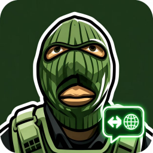
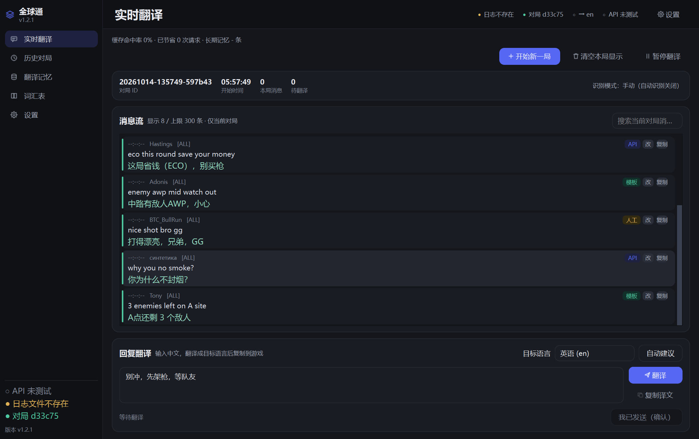
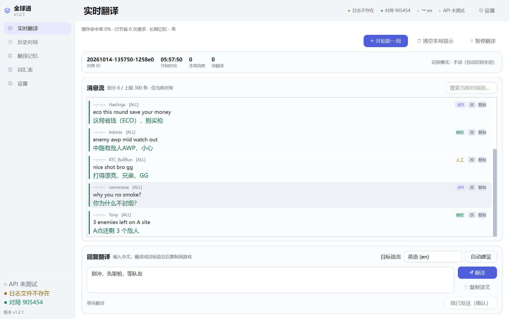
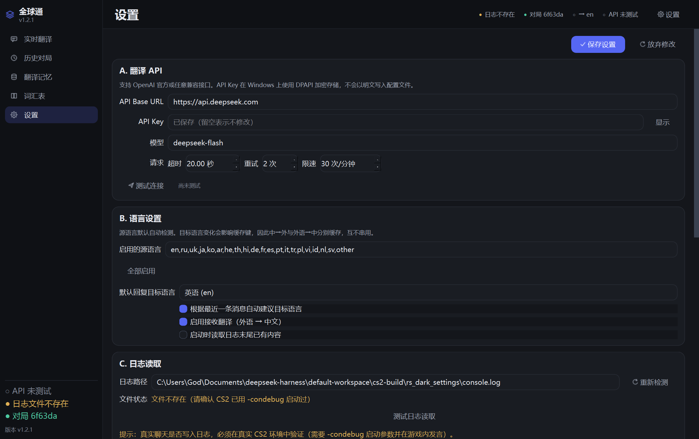
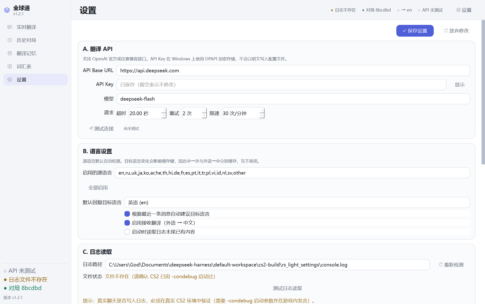
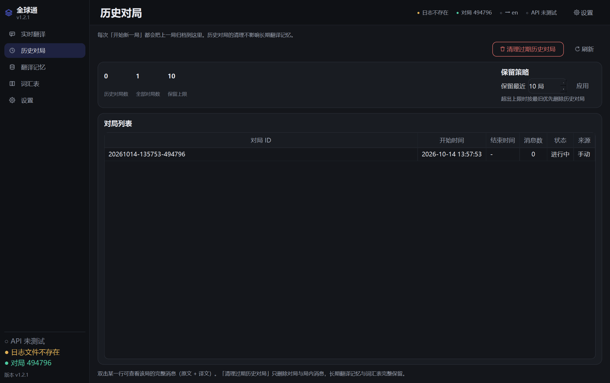
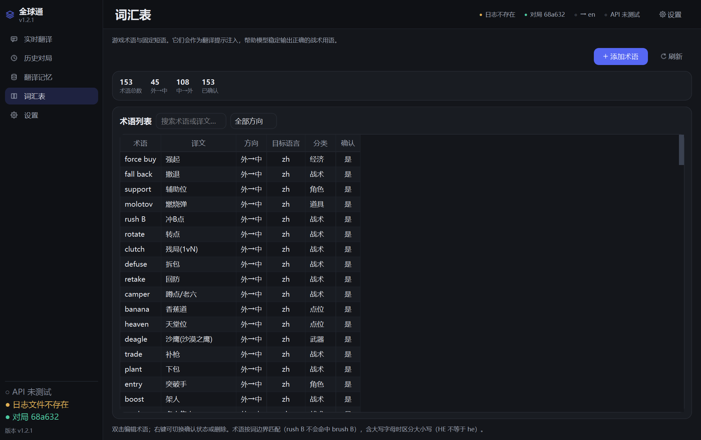

<div align="center">



# QuanQiuTong · 全球通

**A read-only CS2 chat translator for your desktop.**

Reads CS2's own `console.log` and translates in-game chat into Simplified Chinese —
then translates your Chinese replies back into English, Russian, Japanese or Korean.
Ships with a local translation-memory store so repeated sentences never cost you another API call.

No injection · No hooks · No memory reading · No game-file edits · **Trusted Mode stays ON**

[](https://github.com/Goduzun/QuanQiuTong/releases/latest)
[](LICENSE)
[](#requirements)
[](https://www.python.org/)
[](#testing)

[**English**](README.md) · [**简体中文**](README.zh-CN.md)



</div>

---

## Why this exists

Most CS2 translation tools work by **injecting into the game process**.
Valve's [Trusted Mode FAQ](https://help.steampowered.com/en/faqs/view/09A0-4879-4353-EF95) is blunt about that:

> Trusted mode **blocks third-party files from interacting with the game**.
> *Is there a whitelist of software that can be safely injected?* **No.**
> In Trusted mode, **all foreign software is blocked**.

And in normal mode, injection requires signed DLLs — unsigned ones drop CS2 into
**insecure mode**, which **blocks VAC-secure servers** entirely.

**So this project injects nothing.** It only *reads* `console.log` — a plain text file the
game writes and never reads back — and shows translations in its own window. Nothing ever
touches the game process, so Trusted Mode restrictions simply don't apply.

> **The trade-off, stated plainly:** you cannot render text into the native chat HUD this
> way — that would require injection. Translations live in a separate window you keep
> beside the game. **Borderless-windowed mode is recommended** (exclusive fullscreen may
> cover any topmost window).

---

## ⚠️ VAC safety boundary — read this first

**Evaluate the risk yourself before using this tool.** No third-party tool can promise
"100% safe", and this project accepts no responsibility for account bans.

### Everything this tool does at runtime

Exactly three things:

1. Opens CS2's `console.log` — the plain-text file the game writes when launched with
   `-condebug` — in **read-only** mode;
2. Reads new content **incrementally, byte by byte**, and sends recognised chat lines to
   the translation API you configured;
3. Displays source text and translation **in its own window**.

Nothing else. `-condebug` is an official Valve launch parameter and `console.log` is an
ordinary text log the game writes itself. Reading an ordinary text file involves no
operation on the game process, so this tool runs **completely independently of it**.

### Capability boundary

| Dimension | This tool | Concrete meaning |
|---|---|---|
| Game process | Never touches it | No injection, no attach, no memory read/write, no hooks |
| Game files | Never modified | No changes to CS2 or VAC files |
| Network | Outbound API calls only | No interception, no proxying, no tampering with game traffic |
| Input devices | Never captured | No keyboard/mouse simulation; you copy the translation yourself |
| Chat sending | Not implemented | No auto-send or write-back into game chat at all |
| VAC | Nothing aimed at it | Contains no code intended to circumvent VAC |

---

## Features



### 🌍 Live translation
Watches `-condebug` output and translates incoming foreign chat into Simplified Chinese.

- Handles `[ALL]` / `[T]` / `[CT]` channels, dead-player markers, and **full-width colons** (`：`)
- Language detection with Cyrillic heuristics — English, Russian, Chinese and more
- Messages already in Chinese are shown as-is and never sent to the API

### 💬 Reply assistant with honest state tracking
Type Chinese, get English/Russian/Japanese/Korean, paste it into the game yourself.

Three **strictly separated** states — it never claims you sent something you didn't:

```
① Translation ready (not copied)  →  ② Copied to clipboard (not sent)  →  ③ Confirmed sent in game
```

The third state is reachable **only** by you ticking a checkbox. No auto-send, no key simulation.

### 🎯 Per-match isolation
Each match gets its own `match_id` and a generation counter.

- Late-arriving translations are **discarded** once the generation changed
- Switching matches never leaks the previous match's messages into the new one
- Repeated map reloads are de-duplicated (real logs load the same map up to 3×)

### 🧠 Three-tier data retention

| Tier | Contents | New match | Restart |
|---|---|---|---|
| Current match | messages (cap 300) | cleared | cleared |
| Match history | past matches + messages | kept | last N matches kept |
| Long-term memory | cache · glossary · templates | **kept** | **kept** |

On startup the app clears live translations and match history but **keeps your glossary and
translation memory**, so the cache you built up survives every restart. The log read
position also resets to the end of file, so yesterday's messages aren't re-translated.

### 💰 Six-step lookup before spending a cent

```
1. Manual correction   ← highest priority; AI results can never overwrite it
2. Long-term memory    ← identical sentences
3. Glossary            ← word-boundary aware: "rush B" will not match "brush B"
4. Sentence templates  ← numeric slots: "3 enemies left" → "还剩 3 个敌人"
5. Shared cache
6. API call            ← only if every step above missed
```

Cache keys are `(source_hash, target_language, direction, cache_version)`, so the same
sentence translated to English and to Russian is **two independent entries**. Failures
(`NetworkError` / `AuthError` / `EmptyResponseError`) are **never cached** — a network blip
can't poison your memory permanently.

### 🎨 Modern UI
Sidebar navigation, top status bar, five pages, dark and light themes. Every colour pair
meets **WCAG AA** contrast — verified by computation, not by eye.

<div align="center">

| Dark | Light |
|---|---|
|  |  |
|  |  |

<sub>Settings and match history / glossary</sub>

</div>

### 📱 Message ordering — newest at top or bottom
Under **设置 → 消息排列 / Settings → Message order**:

- **Newest at bottom + auto-scroll** (default) — behaves like a chat app
- **Newest at top** — new messages appear at the top, so you never miss one when not scrolling

Auto-scroll respects your reading: scroll up and it **won't** yank you back down —
a **↓ 回到最新 / Back to latest** button appears instead.

---

## Requirements

| | |
|---|---|
| **OS** | Windows 10 / 11 (x64) |
| **GPU** | Anything with Direct3D 11 — i.e. any machine that runs CS2 |
| **Game** | CS2 launched with `-condebug` |
| **API** | Any OpenAI-compatible endpoint (OpenAI, DeepSeek, local Ollama, …) |

> **Why D3D11 matters:** the build excludes Qt's 19.7 MB software-OpenGL fallback
> (`opengl32sw.dll`) to keep the download at **34 MB instead of 54 MB**. Every GPU that can
> run CS2 supports D3D11, so this affects nobody in practice — but on a machine without it,
> the app won't start. See [Building](#building) for how to add it back.

---

## Install

### Option A — download the EXE (recommended)

Grab the latest `QuanQiuTong-*.exe` from
[**Releases**](https://github.com/Goduzun/QuanQiuTong/releases/latest) and run it.
No installer, no Python required.

```powershell
# Optional: verify the download against the SHA-256 published in the release notes
Get-FileHash .\QuanQiuTong-v1.2.1.exe -Algorithm SHA256
```

### Option B — run from source

```powershell
git clone https://github.com/Goduzun/QuanQiuTong.git
cd QuanQiuTong
python -m venv .venv
.\.venv\Scripts\Activate.ps1
pip install -r requirements.txt
python app.py
```

---

## Usage

### 1. Turn on CS2's console log
Steam → CS2 → Properties → **Launch Options**, add:

```
-condebug
```

CS2 then writes `console.log` under
`…\Counter-Strike Global Offensive\game\csgo\`.

### 2. Configure the app
Open **设置 / Settings**:

| Field | What to enter |
|---|---|
| API Base URL | e.g. `https://api.openai.com/v1` or `https://api.deepseek.com` |
| API Key | stored with **Windows DPAPI encryption** — never written as plaintext |
| Model | e.g. `gpt-4o-mini` or `deepseek-chat` |
| Log path | the `console.log` above (the app can auto-detect it) |

### 3. Play
The **实时翻译 / Live translation** page shows incoming chat with translations. Use the
**回复翻译 / Reply** box at the bottom to draft Chinese replies.

---

## Privacy

| | |
|---|---|
| **What the app uploads** | Only the chat text you ask it to translate |
| **What it never uploads** | Your logs, Steam path, API key, glossary, match history |
| **Where data lives** | `%APPDATA%\CS2ChatTranslator\` (config, encrypted key, SQLite memory) |
| **How it reads logs** | Read-only, opened with `FILE_SHARE_READ\|WRITE\|DELETE` so the game can still rotate its own log |

The API key is encrypted with Windows DPAPI and bound to your Windows account.

---

## CLI

```powershell
全球通.exe --version                      # print version
全球通.exe --diagnose <console.log>       # analyse a log locally (nothing is uploaded)
全球通.exe --cli                          # headless: print translations to the terminal
全球通.exe --reply "别冲，先架枪" --to en    # translate one reply and exit
```

`--diagnose` also self-checks the runtime environment — useful when a build is broken:

```
==== 运行环璄自检 ====
  ssl: OK  OpenSSL 1.1.1u  30 May 2023
  openai: OK  2.54.0
```

---

## Building

```powershell
# 1. stage a clean build tree (excludes .git/.venv)
python path\to\stage_project.py

# 2. build the single-file EXE (~34 MB)
pyinstaller QuanQiuTong-onefile.spec --noconfirm --clean
```

The spec's exclusion list is **measured, not guessed** — every entry was justified by PE
import-table analysis rather than intuition. Two things to know before you edit it:

> ⚠️ **Never exclude `libssl-1_1.dll` / `libcrypto-1_1.dll`.**
> Python 3.11's `_ssl.pyd` imports them directly (OpenSSL 1.1.1u). Removing them breaks
> `_ssl` → `openai` can't be imported → **all translation silently stops working**, and the
> GUI only reports it in a single line. This exact mistake shipped in v1.2.0 and was fixed
> in v1.2.1. `TestPackagingSpec` now guards against it.

> ⚠️ **Never exclude `PySide6.QtCore` / `QtGui` / `QtWidgets`.** Obviously required, listed
> here because a bulk edit could drop them.

What the exclusions actually save (all verified by measurement):

| Removed | Saved | Justification |
|---|---|---|
| `opengl32sw.dll` | 19.7 MB | No DLL imports it; `Qt6Gui` uses `d3d11/dxgi/d3d12` |
| `Qt6Quick/Qml/*` | 12.6 MB | QML stack — this app is pure QWidget |
| `Qt6Pdf` | 4.4 MB | Never used |
| `translations` | 6.6 MB | 99 locales → keep only `zh_CN` |
| `Qt6OpenGL/Network` | 3.6 MB | Only pulled in by Quick/Pdf/Qml |
| Extra plugins | 3.3 MB | imageformats/platforms/tls trimmed to the minimum |

---

## Testing

```powershell
python -m pytest tests/ -q
```

**377 tests**, covering log parsing, language detection, cache/lookup ordering, failure
handling, match isolation, the reply state machine, glossary performance, and the
packaging spec itself.

Regression tests worth knowing about:

| Test | Guards against |
|---|---|
| `TestPackagingSpec` | Excluding OpenSSL DLLs (the v1.2.0 bug) |
| `TestDataDirStability` | Renaming `APP_NAME`, which orphans all user data |
| `TestGlossaryPerformance` | The O(n²) column-resize trap (3568 ms → 15 ms) |
| `TestMessageOrderAndAutoscroll` | Auto-scroll silently dying after one message |

---

## Known limitations

- **No native HUD output.** By design — see [Why this exists](#why-this-exists).
  Translations appear in the app window only.
- **Exclusive fullscreen may cover the window.** Use borderless-windowed mode.
- **Automatic match detection is off by default** and its signals are not fully validated
  across many matches; the UI labels it as unverified.
- **Needs `-condebug`.** Without it CS2 writes no `console.log` and there is nothing to read.
- **Machine translation is imperfect.** CS2 chat is full of slang and abbreviations; the
  glossary and manual-correction layers exist precisely to fix that over time.

---

## Credits

This project is an independent Python/PySide6 implementation of a well-known community
idea: *read CS2's console log and translate the chat*. During the initial research phase we
consulted the following public projects to confirm the chat-line format in CS2 logs and the
feasibility of a read-only approach on Windows:

- [MeckeDev/cs_translate](https://github.com/MeckeDev/cs_translate)
- [MeckeDev/cs2-chat-translator](https://github.com/MeckeDev/cs2-chat-translator)
- [rowanchanner/cs2-live-translator-](https://github.com/rowanchanner/cs2-live-translator-)

**There is no code or documentation derivation.** Implementation language, program
structure, UI, translation backends and the local memory store were designed and written
independently; no source code, comments or documentation text were copied. The overlap is
limited to **facts and general methods that are not copyrightable** — namely Valve's own
`-condebug` mechanism and the textual layout of chat lines in `console.log`.

Those repositories currently ship **no open-source licence**, so their code and
documentation remain the property of their respective authors. This project claims no
rights under, and depends on no licence from, those projects.

If you are the author of one of the projects above and feel this statement is inaccurate,
please open an issue and I'll amend or remove it immediately.

See [CHANGELOG.md](CHANGELOG.md) for version history.

---

## License

[MIT](LICENSE) © 2026 Goduzun

This project only reads Valve's official `-condebug` log. It is **not affiliated with Valve
Corporation** in any way. Counter-Strike is a trademark of Valve Corporation.
